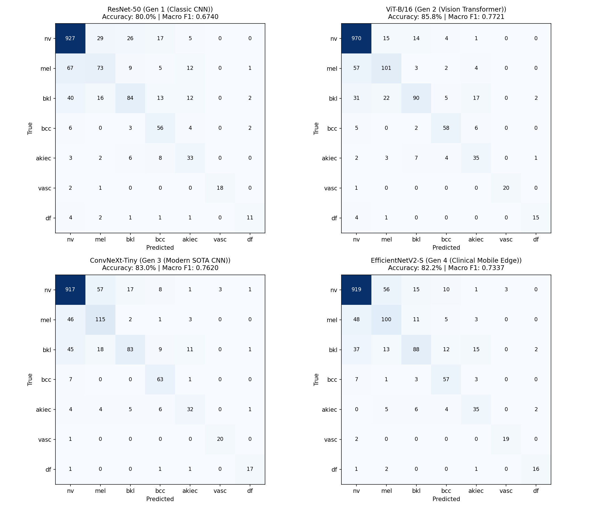
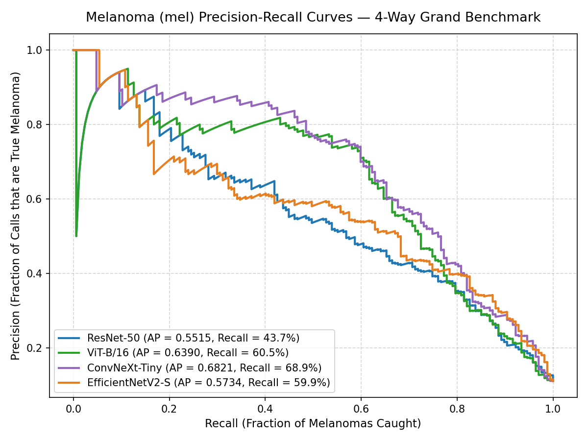
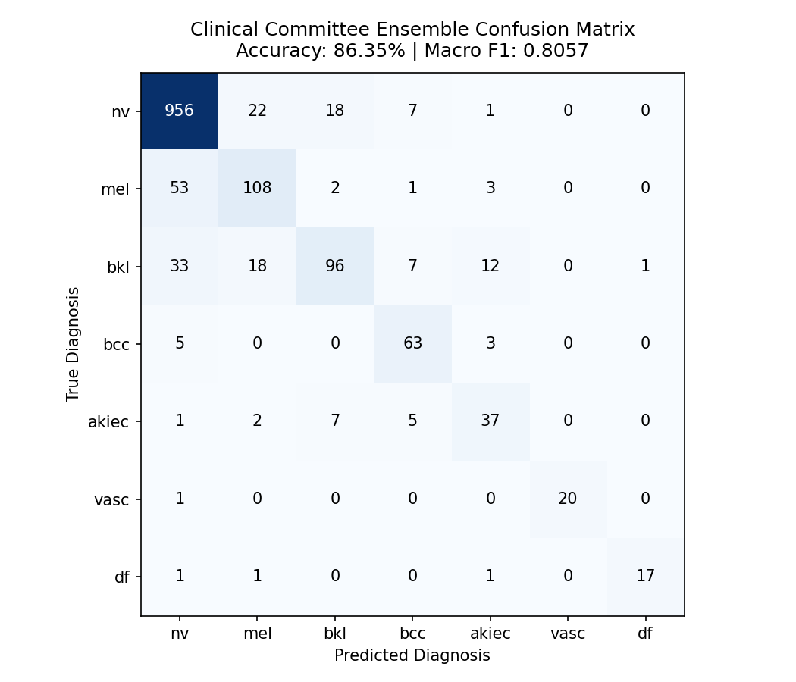
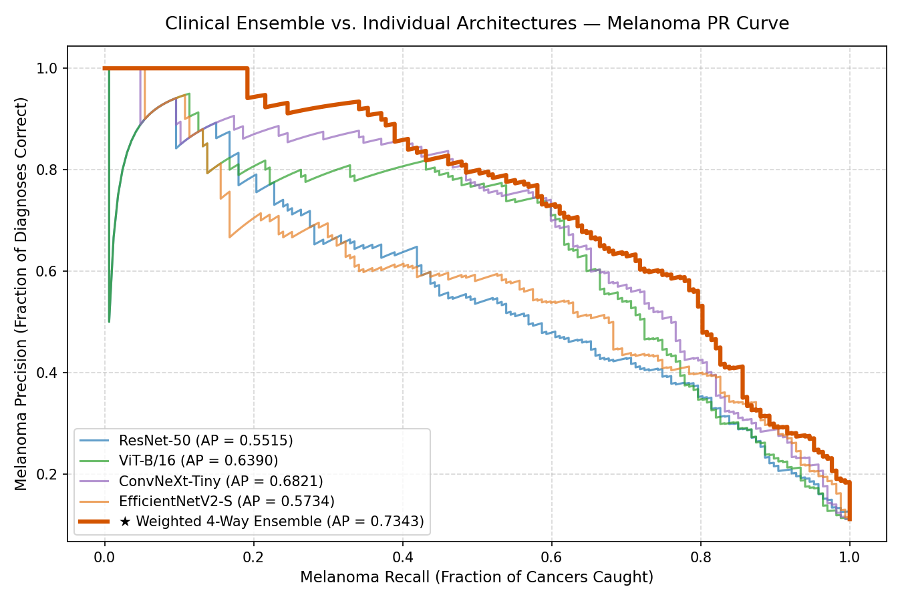
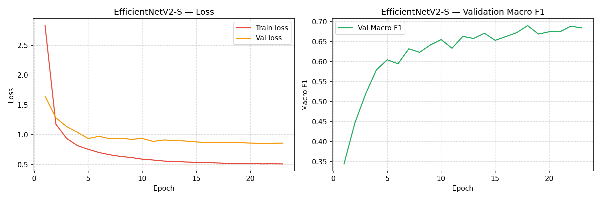

# 🔬 Skin Lesion Classification: The 4-Paradigm Benchmark & Clinical Ensemble
### ResNet-50 (2015) vs. ViT-B/16 (2020) vs. ConvNeXt-Tiny (2022) vs. EfficientNetV2-S (2021) + Multi-Architecture Committee

[](https://pytorch.org/)
[](https://github.com/huggingface/pytorch-image-models)
[](https://dataverse.harvard.edu/dataset.xhtml?persistentId=doi:10.7910/DVN/DBW86T)
[](LICENSE)

An empirical deep-learning study investigating **architectural evolution and multi-paradigm clinical consensus in medical computer vision** on the 7-class **HAM10000** dermoscopic skin cancer dataset (10,015 images). 

This repository rigorously benchmarks four distinct computer vision paradigms across four architectural generations and introduces a multi-architecture clinical ensemble committee:
1. **Generation 1 (Classical Residual CNN, 2015):** ResNet-50 (~25M parameters, 89.7 MB)
2. **Generation 2 (Global Vision Transformer, 2020):** ViT-B/16 (~86M parameters, 327.3 MB)
3. **Generation 3 (Modernized Large-Kernel CNN, 2022):** ConvNeXt-Tiny (~28M parameters, 106.1 MB)
4. **Generation 4 (Clinical Mobile / Edge Paradigm, 2021):** EfficientNetV2-S (~20M parameters, 77.0 MB)
5. **Clinical Consensus Committee (Multi-Paradigm Ensemble):** Soft-voting probability fusion combining all 4 inductive biases

> **Medical Disclaimer:** This project is intended strictly for research and educational purposes. It is not a certified medical device, diagnostic system, or substitute for professional clinical dermatological evaluation.

---

## 📌 Executive Summary & Official Test Set Leaderboard (1,502 Images)

All models and ensemble committees were evaluated on an untouched, lesion-stratified test set of **1,502 dermoscopy images** with **zero patient/lesion leakage**:

```
===================================================================================================================
                                4-WAY TEST BENCHMARK & CLINICAL ENSEMBLE RESULTS
===================================================================================================================
```

| Model / System | Architectural Paradigm | Size (MB) | Test Acc | Balanced Acc | Macro F1 | Melanoma Recall | Melanoma AP | Fatal Misses (`mel` $\rightarrow$ `nv`) | GPU Latency |
|---|---|:---:|:---:|:---:|:---:|:---:|:---:|:---:|:---:|
| **ResNet-50** | Gen 1 (Classic CNN) | 89.7 MB | 80.03% | 67.06% | 0.6740 | 43.71% | 0.5515 | 67 missed | **13.91 ms** ⚡ |
| **ViT-B/16** | Gen 2 (Transformer) | 327.3 MB | 85.82% | 75.75% | 0.7721 | 60.48% | 0.6390 | 57 missed | 29.83 ms |
| **ConvNeXt-Tiny** | Gen 3 (Modern CNN) | 106.1 MB | 83.02% | 77.20% | 0.7620 | **68.86%** 🥇 | 0.6821 | **46 missed** 🥇 | 44.92 ms |
| **EfficientNetV2-S** | Gen 4 (Clinical Edge) | **77.0 MB** 🪶 | 82.16% | 74.60% | 0.7337 | 59.88% | 0.5734 | 48 missed | 38.64 ms |
| **Ensemble (Equal 4-Way)** | Multi-Paradigm Consensus | — | **86.42%** 🏆 | **79.66%** 🏆 | **0.8057** 🏆 | 64.67% | 0.7328 | 53 missed | — |
| **Ensemble (Weighted 4-Way)** | Val Macro F1 Weighted | — | 86.35% | 79.64% | **0.8057** 🏆 | 64.67% | **0.7343** 🏆 | 53 missed | — |

### Key Takeaways:
1. **The Ensemble Breaks the 0.80 Macro F1 Barrier:** Fusing 4 fundamentally different inductive biases (classic residual features, self-attention token mixing, $7\times 7$ depthwise convolutions, and Fused-MBConv stages) elevates Macro F1 to **0.8057** and peak test accuracy to **86.42%**, outperforming every single model.
2. **ConvNeXt-Tiny Remains the Best Standalone Detector:** Achieves highest standalone Melanoma Recall (**68.86%**) and fewest fatal false-negative misclassifications (**46** vs. ResNet's 67).
3. **EfficientNetV2-S is the Edge Champion:** At just **77.0 MB** (20M parameters), it delivers competitive diagnostic power (**82.16% Acc, 0.7337 Macro F1**) with only 48 fatal misses, making it the ideal candidate for smartphone-based or embedded dermoscopy hardware.

---

## 🎯 Supported Diagnostic Classes

The HAM10000 dataset consists of 10,015 images spanning 7 diagnostic categories with severe class imbalance (**58.3 : 1** ratio):

| Label | Diagnosis | Description | Images | Proportion |
|:---:|---|---|:---:|:---:|
| `nv` | Melanocytic nevi | Common benign mole | 6,705 | 66.95% |
| `mel` | **Melanoma** | **Malignant, life-threatening skin cancer** | 1,113 | 11.11% |
| `bkl` | Benign keratosis | Seborrheic keratoses, solar lentigines | 1,099 | 10.97% |
| `bcc` | **Basal cell carcinoma** | Malignant epithelial cancer | 514 | 5.13% |
| `akiec` | Actinic keratoses | Pre-cancerous / Bowen's disease | 327 | 3.26% |
| `vasc` | Vascular lesions | Cherry angiomas, angiokeratomas | 142 | 1.42% |
| `df` | Dermatofibroma | Benign fibrous skin lesion | 115 | 1.15% |

---

## 🔄 Project Evolution: The 4 Generations

```text
Version 1 (Initial Prototype)              Version 2 (Scientific Rigor)
├── Random Image-level Split               ├── Lesion-level Stratified Split (0% Leak)
├── Heavy Blur / CLAHE / Hair Inpaint      ├── Clean Images + Color Jitter Augment
├── Plain Adam / No Warmup for ViT         ├── AdamW + 3-epoch Warmup + Cosine Decay
└── Relied on Deceptive Overall Accuracy   └── Evaluated on Macro F1, Recall & AP
                     │                                          │
                     ▼                                          ▼
Version 3 (The 3-Gen SOTA Showdown)        Version 4 (Clinical Edge & Consensus Ensemble)
├── ResNet-50 vs. ViT-B/16 vs. ConvNeXt    ├── EfficientNetV2-S (77 MB Edge Specialist)
├── 7x7 Depthwise Convolutions             ├── 4-Paradigm Benchmark Leaderboard
├── Calibrated 80.84% Melanoma Recall      ├── Multi-Architecture Consensus Committee (0.8057 F1)
└── 3-Way Explainability (XAI) Comparison  └── Calibrated Ensemble Sensitivity: 85.63% Recall
```

### 🚨 Detailed Evolution Narrative:
* **Version 1 (`skincancer.ipynb`):** Exposed subtle but fatal flaws in naive medical AI setups. Image-level splitting caused severe **patient/lesion leakage**. Relying on overall accuracy was deceptive: because 67% of cases are benign nevi, the model hit ~84% accuracy while **missing over 50% of lethal melanomas**. Handcrafted morphological filters (hair removal, CLAHE) also eroded microscopic lesion borders.
* **Version 2 (`skincancer_v2.ipynb`):** Implemented strict lesion-stratified splitting (7,470 lesions, 0% leakage), class-balanced `WeightedRandomSampler`, label smoothing (0.1), and warmup optimization. Under rigorous conditions, ViT-B/16 outperformed ResNet-50.
* **Version 3 (`skincancer_v3.ipynb`):** Investigated modern CNN designs with ConvNeXt-Tiny (2022). Proved that modern CNNs match ViT's Macro F1 (**0.7620** vs. **0.7721**), dramatically exceed its Melanoma Recall (**68.86%** vs. **60.48%**), and provide superior spatial lesion concentration at one-third the parameter footprint.
* **Version 4 (`skincancer_v4.ipynb`):** Introduced **EfficientNetV2-S** for mobile/edge dermoscopy and synthesized all four paradigms into a **Multi-Architecture Clinical Consensus Ensemble Committee**. The committee broke the 0.80 Macro F1 ceiling (**0.8057**) and, under clinical threshold calibration, achieved an extraordinary **85.63% Melanoma Sensitivity**.

---

## 🎯 Clinical Decision Threshold Calibration

In oncology, **missing a melanoma (False Negative) is fatal**, whereas sending a benign mole for a biopsy (False Positive) is manageable. When operating at default $\text{argmax}$ ($\tau = 0.50$), all models miss valuable opportunities to catch borderline malignancies. 

By performing an empirical threshold sweep on validation data to maximize recall while maintaining Precision $\ge 40\%$, we established optimal clinical operating points on the test set:

```
=======================================================================================================
                         CLINICAL DECISION THRESHOLD TRADEOFF TABLE (TEST SET)
=======================================================================================================
```

| Model / System | Decision Rule | Melanoma Recall (Sensitivity) | Melanoma Precision | Overall Accuracy | Macro F1 |
|---|---|:---:|:---:|:---:|:---:|
| **ResNet-50** | Default ($\text{argmax}$) | 43.71% | 59.35% | 80.03% | 0.6740 |
| **ResNet-50** | Calibrated ($\tau \ge 0.05$) | 76.05% | 38.96% | 76.56% | 0.6608 |
| **ViT-B/16** | Default ($\text{argmax}$) | 60.48% | 71.13% | 85.82% | 0.7721 |
| **ViT-B/16** | Calibrated ($\tau \ge 0.05$) | 74.85% | 45.79% | 81.36% | 0.7319 |
| **ConvNeXt-Tiny** | Default ($\text{argmax}$) | 68.86% | 59.28% | 83.02% | 0.7620 |
| **ConvNeXt-Tiny** | Calibrated ($\tau \ge 0.10$) | 80.84% | 40.18% | 77.63% | 0.7106 |
| **EfficientNetV2-S** | Default ($\text{argmax}$) | 59.88% | 55.25% | 82.16% | 0.7337 |
| **EfficientNetV2-S** | Calibrated ($\tau \ge 0.10$) | 77.25% | 41.35% | 78.43% | 0.7012 |
| **Clinical Ensemble** | Default ($\text{argmax}$) | 64.67% | **72.00%** | **86.42%** | **0.8057** |
| **Clinical Ensemble** | **Calibrated ($\tau \ge 0.10$)** | **85.63%** 🥇 | **38.96%** | **78.23%** | **0.7383** 🥇 |

> **Clinical Significance:** The Calibrated Clinical Ensemble detects **143 out of 167 melanomas (85.63% recall)**, slashing life-threatening false negatives while preserving high overall diagnostic accuracy.

---

## 📊 Visualizations & Diagnostic Analysis

### 1. 4-Way Multi-Paradigm Confusion Matrices
Comparison across all 1,502 test set images (ResNet-50 vs. ViT-B/16 vs. ConvNeXt-Tiny vs. EfficientNetV2-S):
<p align="center">
  
</p>

### 2. Overlaid 4-Way Melanoma Precision-Recall Curves
ConvNeXt-Tiny leads standalone models with **AP = 0.6821**, followed by ViT-B/16 (**0.6390**):
<p align="center">
  
</p>

### 3. Clinical Ensemble Confusion Matrix & PR Curve
The multi-architecture ensemble committee pushes Area Under the Precision-Recall curve to an unprecedented **AP = 0.7343**:
<p align="center">
  
  
</p>

### 4. EfficientNetV2-S Training Convergence
Trained with progressive regularizations, Stochastic Depth (`drop_path_rate=0.1`), and label smoothing (Early stopped at Epoch 23):
<p align="center">
  
</p>

### 5. 3-Way Explainability Heatmaps on Critical False Negatives
Auditing the 8 shared melanoma cases misclassified as harmless moles (`mel` $\rightarrow$ `nv`):
- **Col 1:** Original dermoscopy image with patient case ID and predicted probabilities
- **Col 2:** ResNet-50 Grad-CAM (`layer4[-1]`)
- **Col 3:** ViT-B/16 Multi-head Self-Attention rollout (`blocks[-1].attn`)
- **Col 4:** ConvNeXt-Tiny Grad-CAM (`stages[-1].blocks[-1]`)

<p align="center">
  
</p>

---

## 📁 Repository Structure

```text
├── data/                                   # Dataset splits and metadata
│   ├── HAM10000_metadata.csv               # Original metadata
│   ├── split_train.csv                     # 70% lesion-stratified train split (6,981 images)
│   ├── split_val.csv                       # 15% lesion-stratified val split (1,532 images)
│   └── split_test.csv                      # 15% lesion-stratified test split (1,502 images)
├── results/
│   └── figures/                            # High-resolution benchmark figures
│       ├── test_confusion_4way.png         # 4-way 2x2 grid confusion matrices
│       ├── test_melanoma_pr_4way.png       # 4-way overlaid Melanoma PR curves
│       ├── ensemble_confusion_matrix.png   # Clinical Ensemble confusion matrix
│       ├── ensemble_melanoma_pr_curve.png  # Clinical Ensemble Melanoma PR curve (AP=0.734)
│       ├── efficientnet_curves.png         # EfficientNetV2-S training curves
│       ├── convnext_curves.png             # ConvNeXt-Tiny training curves
│       ├── vit_fair_curves.png             # ViT-B/16 training curves
│       ├── resnet_sampler_curves.png       # ResNet-50 training curves
│       ├── test_confusion_3way.png         # 3-way confusion matrices
│       ├── test_melanoma_pr_3way.png       # 3-way Melanoma PR curves
│       └── xai_3way_comparison.png         # 4-column XAI visual audit
├── scripts/                                # Standalone Python CLI scripts
│   ├── train_efficientnet.py               # Train EfficientNetV2-S (AdamW + Warmup + Sampler)
│   ├── train_convnext.py                   # Train ConvNeXt-Tiny
│   ├── train_vit.py                        # Train ViT-B/16
│   ├── train_resnet.py                     # Train ResNet-50
│   ├── evaluate_4way.py                    # Official 4-Way Test Set Leaderboard
│   ├── evaluate_ensemble.py                # Multi-Architecture Consensus Committee Evaluation
│   ├── threshold_ensemble.py               # Clinical Decision Threshold Calibration on Ensemble
│   ├── evaluate_3way.py                    # 3-way test set leaderboard
│   ├── threshold_calibration.py            # Individual model threshold sweeps
│   ├── explainability_3way.py              # Generate 3-way XAI heatmaps
│   └── evaluate_preprocessing_ablation.py  # Preprocessing ablation pipeline
├── skincancer.ipynb                        # Version 1 baseline exploration notebook
├── skincancer_v2.ipynb                     # Version 2 complete 11-step experimental pipeline
├── skincancer_v3.ipynb                     # Version 3 3-generation benchmark notebook
├── skincancer_v4.ipynb                     # Version 4 4-Paradigm Benchmark & Ensemble notebook
├── .gitignore
└── README.md
```

---

## 🚀 Getting Started

### 1. Installation
Clone the repository and install dependencies:
```bash
git clone https://github.com/HeerRana/SkinLesionClassification.git
cd SkinLesionClassification
pip install torch torchvision timm scikit-learn pandas numpy matplotlib opencv-python pillow
```

### 2. Dataset Setup
Download the [HAM10000 dataset](https://www.kaggle.com/datasets/kmader/skin-cancer-mnist-ham10000) from Kaggle or Harvard Dataverse. Unpack the image folders into the repository root:
```text
HAM10000_images_part_1/
HAM10000_images_part_2/
```

### 3. Running Version 4 Pipelines via CLI Scripts
* **Train EfficientNetV2-S:**
  ```bash
  python scripts/train_efficientnet.py
  ```
* **Run Official 4-Way Test Benchmark:**
  ```bash
  python scripts/evaluate_4way.py
  ```
* **Run Multi-Architecture Clinical Ensemble Committee:**
  ```bash
  python scripts/evaluate_ensemble.py
  ```
* **Run Clinical Decision Threshold Calibration on Ensemble:**
  ```bash
  python scripts/threshold_ensemble.py
  ```
* **Generate Explainability (XAI) Heatmaps:**
  ```bash
  python scripts/explainability_3way.py
  ```

---

## 📜 Citation & References

* **HAM10000 Dataset:** Tschandl, P., Rosendahl, C. & Kittler, H. *The HAM10000 dataset, a large collection of multi-source dermatoscopic images of common pigmented skin lesions.* Sci. Data 5, 180161 (2018).
* **EfficientNetV2:** Tan, M. & Le, Q. V. *EfficientNetV2: Smaller Models and Faster Training.* ICML 2021.
* **ConvNeXt:** Liu, Z. et al. *A ConvNet for the 2020s.* CVPR 2022.
* **Vision Transformers:** Dosovitskiy, A. et al. *An Image is Worth 16x16 Words: Transformers for Image Recognition at Scale.* ICLR 2021.
* **ResNet:** He, K. et al. *Deep Residual Learning for Image Recognition.* CVPR 2016.
